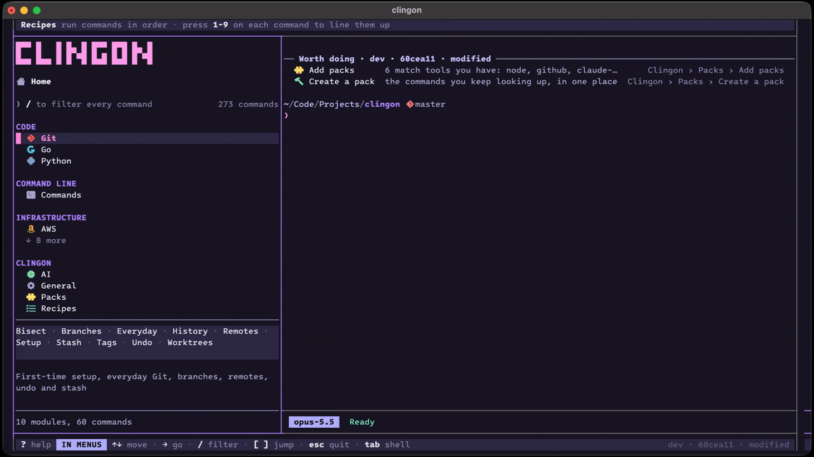

# clingon

**Stop googling commands. Pick them from a menu, fill in the blanks, and run them in a real dedicated shell.**

```sh
brew install con-dog/tap/clingon
clingon
```



Needs macOS, with zsh or bash. Opens in its own window, with its own custom font and colours.

- **It's your real shell.** Your config, your aliases, your environment. clingon types the command in for you, then gets out of the way.
- **It checks before risky commands.** ⚠ commands ask No/Yes first. ☠ commands can't be undone, so you type a short code before they run.
- **Commands are just Markdown.** A pack is a folder of `.md` files that reads as docs on GitHub and runs in clingon. Make your own with `clingon pack create`. [How packs work →](docs/packs.md)
- **Chain commands into recipes.** Press `1`–`9` on commands to line them up, then run them in order. It stops if one fails. [How recipes work →](docs/recipes.md)

**Packs:** `files`, `network`, `package-managers`, `ssh` and `system` to begin with. Add `aws`, `claude-code`, `codex`, `docker`, `dotnet`, `git`, `github`, `go`, `macos`, `node`, `playwright`, `postgres`, `python`, `redis` and `security` with `clingon pack add <name>`. More to come!

Press `?` in clingon for every key.

## Why clingon?

| | clingon | navi | tldr | fzf |
|---|:-:|:-:|:-:|:-:|
| Finds commands you've never run | ✓ | ✓ | ✓ | – |
| Fills in the blanks for you | ✓ | ✓ | – | – |
| Runs it in your shell | ✓ | ✓ | – | ✓ |
| Asks before risky commands | ✓ | – | – | – |
| Chains commands into recipes | ✓ | – | – | – |

## Good to know

- **It never changes your setup.** clingon reads your shell config as usual and never writes to it. Its prompt and colours apply only inside its own window.
- **What it adds:** its own font, and a "clingon" profile in Terminal or iTerm2. macOS asks once whether clingon may control those apps, only to open and style the window.
- **Separate history.** Unless your config sets `HISTFILE`, zsh inside clingon keeps its own history.
- **Its files** are in `~/.clingon`: your packs and recipes, plus its own files in `~/.clingon/config`. Set `$CLINGON_CONFIG` to move it.
- **Over SSH**, use `eval "$(clingon print)"` to pick a command and run it.
- **Something wrong?** Run `clingon doctor`, or `clingon crash` to see why it last crashed. Update with `clingon update`.
- **Zero Telemetry.** Clingon collects nothing about you or your commands. It only goes online to check for a new release once a day, and when you add or update packs. The AI is off until you add an OpenRouter key; then each task you give it goes to OpenRouter and the model's maker, with the menu as text and the shell's last lines.

## Removing clingon

```sh
brew uninstall clingon
rm -rf ~/.clingon
rm -f ~/Library/Fonts/ClingonMono-*.otf
rm -f ~/Library/Application\ Support/iTerm2/DynamicProfiles/clingon.json  # iTerm2
rm -rf ~/Library/Caches/clingon                                          # Terminal
```

If you use Terminal, also delete any profiles named "clingon" in Settings › Profiles.

## Hacking on clingon

```sh
go build -o clingon ./cmd/clingon && ./clingon
go test ./...
```

## License

MIT
